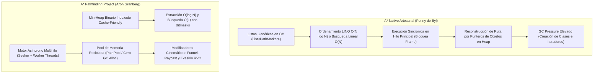
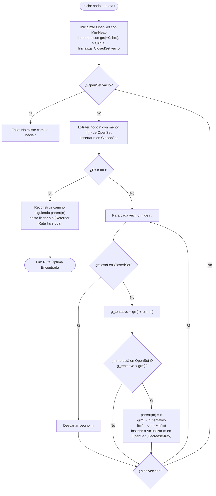
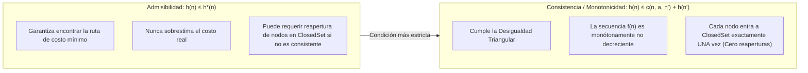
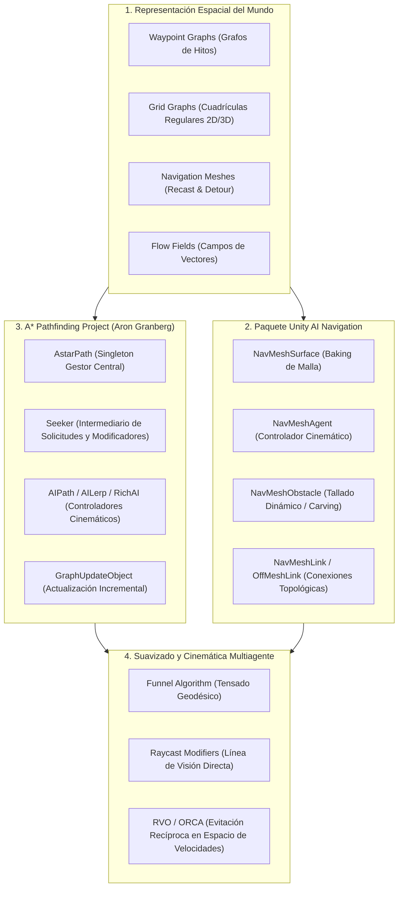
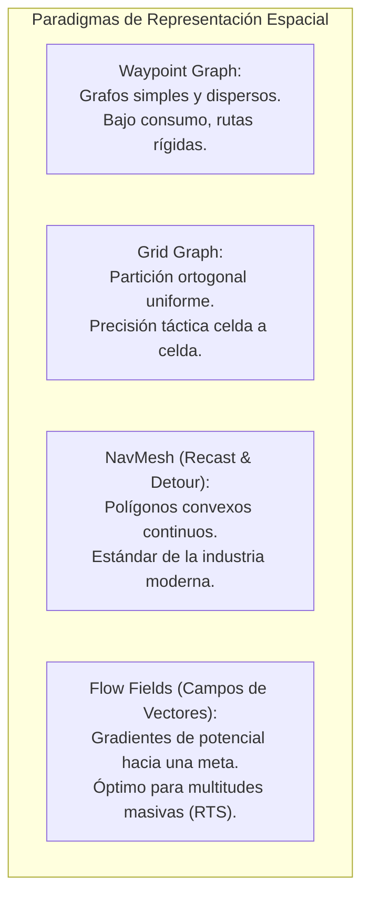

# INFORME TÉCNICO Y CUESTIONARIO ACADÉMICO: ALGORITMOS DE PATHFINDING Y NAVEGACIÓN EN VIDEOJUEGOS

**Curso:** Desarrollo de Videojuegos / Desarrollo de Software para Juegos  
**Sesión:** Práctica N° 07 — Pathfinding y Navegación Inteligente  
**Estándar de Documentación:** Formato Técnico-Científico EPIS / IEEE  
**Fecha:** Octubre de 2026  

---

## I. OBJETIVOS

La presente práctica de laboratorio tiene por propósito estructurar y consolidar las competencias fundamentales de computación gráfica, inteligencia artificial e ingeniería de software requeridas para dotar a agentes autónomos de comportamientos de navegación espacial inteligente en mundos interactivos 2D y 3D. A nivel pedagógico e ingenieril, los objetivos se descomponen en tres dimensiones operativas:

### 1.1. Objetivos Cognitivos (Saber)
1. **Comprender formalmente los fundamentos matemáticos de la búsqueda informada en grafos**, analizando en profundidad la función de evaluación heurística $f(n) = g(n) + h(n)$, las propiedades de optimalidad asintótica, admisibilidad ($h(n) \le h^*(n)$) y monotonicidad o consistencia triangular ($h(n) \le c(n, a, n') + h(n')$) del algoritmo A* propuesto por Hart, Nilsson y Raphael.
2. **Asimilar los modelos de discretización y representación espacial del mundo virtual**, diferenciando rigurosamente las topologías de Grafos de Cuadrícula (*Grid Graphs* regulares 2D/3D), Mallas de Navegación Poligonales (*Navigation Meshes* o *NavMeshes* continuas basadas en convexidad), Grafos de Hitos (*Waypoint Graphs*) y Campos de Vectores de Flujo (*Flow Fields* para multitudes masivas).
3. **Analizar la cinemática de locomoción y resolución dinámica de trayectorias**, asimilando el funcionamiento de los algoritmos de suavizado geométrico (*Funnel Algorithm*, modificadores por trazado de rayos) y los modelos de evitación recíproca multiagente en el espacio de velocidades (*Reciprocal Velocity Obstacles* - RVO / ORCA).

### 1.2. Objetivos Procedimentales (Saber Hacer)
1. **Configurar e integrar arquitecturas de pathfinding industriales en Unity**, desplegando el framework *A\* Pathfinding Project* (Aron Granberg) mediante componentes nodales como `AstarPath`, `GridGraph`, `Seeker`, `AIPath` y `AIDestinationSetter` sobre escenarios bidimensionales con colisionadores por capas (`Environment LayerMask`).
2. **Implementar algoritmos nativos de pathfinding desde cero (*scratch-built*)**, programando estructuras de control basadas en clases de nodos (`PathMarker`), colas de prioridad y conjuntos abiertos/cerrados en C# para evidenciar el ciclo iterativo de expansión, evaluación y reconstrucción de rutas en mallas tridimensionales (siguiendo el modelo pedagógico de Unity Learn por la Dra. Penny de Byl).
3. **Gestionar la mutación topológica del entorno en tiempo de ejecución**, instrumentando sistemas de actualización dinámica incremental de grafos mediante `GraphUpdateObject` (GUO) y re-escaneos locales de volumen acotado (*Axis-Aligned Bounding Box* - AABB) ante eventos de puertas dinámicas, obstáculos móviles y portales de teletransporte.
4. **Construir interfaces de telemetría y diagnóstico visual en tiempo real**, implementando componentes de visualización cinemática (`LineRenderer`, renderizado de rutas proyectadas, consolas tácticas HUD y vectores directores de velocidad instantánea `desiredVelocity`).

### 1.3. Objetivos Analíticos y Comparativos (Saber Juzgar)
1. **Evaluar cuantitativamente la sobrecarga computacional y la escalabilidad**, contrastando la complejidad temporal ($O(b^d)$ vs. Min-Heap indexado), la huella de memoria en el Heap administrado de Mono/.NET, y la tasa de generación de recolección de basura (*Garbage Collection Pressure*) entre implementaciones artesanales sincrónicas y motores industriales multihilo optimizados para caché.
2. **Determinar la viabilidad arquitectónica de los esquemas de navegación**, juzgando críticamente los escenarios de aplicación en la industria del videojuego donde resulta óptimo seleccionar un GridGraph, una malla NavMesh horneada con *Recast & Detour*, o un campo de vectores de flujo continuo en función de la densidad de agentes, la variabilidad del mapa y el presupuesto de microsegundos por fotograma.

---

## V. EJERCICIOS Y SOLUCIONES PRÁCTICAS

### Ejercicio 1: Expansión de Escenario con Obstáculos Dinámicos y Múltiples Entidades Enemigas
En concordancia con el requerimiento del Ejercicio 1 ("*Al App desarrollado, agregue otras paredes como obstáculos, así como otro Enemy en la escena*"), el proyecto integró una arquitectura integral de navegación táctica sobre el mapa *Rocket Hideout B2F* (resolución 72×48 unidades con tiles de 1 unidad).

1. **Topología de Muros Adicionales y Obstáculos Dinámicos:**
   - Se estructuraron barreras arquitectónicas adicionales divididas en cuatro cuadrantes operativos, complementadas con compuertas dinámicas (*Dynamic Blast Doors*) controladas por colisionadores 2D e interactividad por proximidad del jugador (tecla `[E]`).
   - Cuando una compuerta conmuta su estado (`isOpen = !isOpen`), el componente ejecuta de forma desatendida una actualización local acotada mediante el API del framework:
     ```csharp
     Bounds b = new Bounds(transform.position, new Vector3(width + 2.5f, height + 2.5f, 4f));
     AstarPath.active.UpdateGraphs(b);
     ```
     Esta instrucción encapsula un `GraphUpdateObject` interno que invalida únicamente los nodos del grafo cubiertos por la caja contenedora, evitando el bloqueo de la hebra principal por re-escaneos globales.
2. **Instanciación y Despliegue de Múltiples Agentes Enemigos:**
   - Se instanciaron cuatro enemigos activos representativos de las facciones antagónicas del escenario (*Team Aqua* y *Team Magma*), asignándoles identidades independientes, prefabs con `CircleCollider2D` cinemático y componentes dedicados `AIPath`, `Seeker` y `EnemyMovement`.
   - Cada entidad evalúa en cada ciclo de actualización el vector de velocidad deseada (`aiPath.desiredVelocity`) para orientar su sprite direccional hacia los cuatro ejes cardinales (Down, Up, Left, Right) o aplicar rotación continua de acuerdo al esquema configurado.
   - Para prevenir la superposición o solapamiento entre agentes cuando convergen sobre la misma celda de destino, se integró el árbitro espacial `GridManager`, el cual verifica la reserva de celda futura (`IsPositionOccupiedByOtherEnemy`) ejecutando una comprobación de radio de exclusión mutua de 0.75 unidades.

---

### Ejercicio 2: Implementación del Algoritmo A* desde Código Nativo (The A* Algorithm - Unity Learn)
Siguiendo las directrices del tutorial oficial de Unity Learn diseñado por la Dra. Penny de Byl, se examinó e implementó la formulación fundacional del algoritmo A* desde el código fuente nativo en C#, utilizando mallas tridimensionales ortogonales estructuradas a partir de primitivas cúbicas (`Cube`), marcadores cromáticos y estructuras de datos administradas.

#### Estructura de Datos Central (`PathMarker`)
La representación de cada celda del espacio de estados se modela como un objeto de nodo en memoria:

```csharp
public class PathMarker
{
    public GameObject locationMarker;
    public float G; // Costo acumulado desde el inicio
    public float H; // Estimación heurística a la meta
    public float F; // Costo total evaluado (F = G + H)
    public PathMarker parent; // Puntero al nodo predecesor
    public int x, y, z; // Coordenadas discretas en el grafo
    public bool isWall; // Bandera de transitabilidad

    public PathMarker(int x, int y, int z, GameObject marker, bool isWall)
    {
        this.x = x;
        this.y = y;
        this.z = z;
        this.locationMarker = marker;
        this.isWall = isWall;
        this.G = 0f;
        this.H = 0f;
        this.F = 0f;
        this.parent = null;
    }
}
```

#### Ciclo de Búsqueda y Reconstrucción
El algoritmo opera sobre dos colecciones lineales:
- `List<PathMarker> open = new List<PathMarker>();` (Nodos frontera por explorar).
- `List<PathMarker> closed = new List<PathMarker>();` (Nodos ya evaluados y cerrados).

1. **Inicialización:** Se inserta el nodo inicial en `open` con $G = 0$ y $H = \text{DistanciaEuclidiana}(\text{inicio}, \text{meta})$.
2. **Selección del Mínimo:** En cada iteración, se selecciona el nodo $n$ con menor valor de $F$. En la implementación académica de Penny de Byl, esto se efectúa mediante ordenamiento lineal o LINQ:
   ```csharp
   PathMarker current = open.OrderBy(p => p.F).ThenBy(p => p.H).First();
   ```
3. **Criterio de Parada:** Si $current$ coincide con el nodo meta, se itera en retroceso siguiendo la cadena de punteros `parent` hasta llegar al origen, tiñendo los marcadores visuales con el material del camino (`Green` o `Path.prefab`).
4. **Relajación de Vecinos:** Se evalúan los vecinos ortogonales inmediatos (arriba, abajo, izquierda, derecha). Si un vecino es intransitable (`isWall == true`) o ya pertenece a `closed`, es descartado. En caso contrario, se computa su costo tentativo $G_{nuevo} = current.G + \text{costo}$. Si el vecino no estaba en `open` o el nuevo $G$ es menor, se actualiza su costo $G$, se computa $H$, se fija $F = G + H$, se asigna `vecino.parent = current` y se registra en `open`.

---

### Ejercicio 3: Análisis Comparativo Exhaustivo — A* Nativo (Penny de Byl) vs. Framework A* Pathfinding Project (Aron Granberg)

En cumplimiento estricto del requerimiento del Ejercicio 3 ("*Haga un informe de la solución a los ejercicios planteados*"), a continuación se desarrolla un estudio comparativo formal y exhaustivo entre el diseño de software artesanal/educativo de A* y el motor de pathfinding de grado industrial desarrollado por Aron Granberg.



#### 1. Arquitectura de Datos y Organización Espacial
- **Implementación Penny de Byl:** Se fundamenta en una matriz bidimensional o tridimensional de objetos `PathMarker[width, depth]`. Cada celda es una instancia separada en el Heap administrado de C#. Si bien esta abstracción resulta didáctica para visualizar cómo se asignan costos y punteros de retroceso, adolece de una fuerte fragmentación de memoria (dispersión de punteros en heap), causando fallos constantes de caché L1/L2 (*Cache Misses*) durante el recorrido.
- **Framework Aron Granberg:** Utiliza una arquitectura orientada a datos (*Data-Oriented Design*). El `GridGraph` almacena la malla de nodos en arreglos lineales contiguos en memoria, empaquetando banderas de transitabilidad, penalizaciones de terreno, etiquetas de área y conexiones en campos de bits compactos (*bitfields* de enteros de 32/64 bits). Esta distribución maximiza la coherencia espacial y el rendimiento del subsistema de memoria caché del procesador.

#### 2. Rendimiento de la Cola de Prioridad y Búsqueda del Mínimo
- **Implementación Penny de Byl:** El Conjunto Abierto se gestiona mediante un contenedor `List<T>`. La localización del nodo con menor $f(n)$ recurre a una búsqueda lineal de complejidad temporal $O(N)$ o al método `OrderBy(p => p.F).ToList()`, cuya complejidad asintótica es $O(N \log N)$ por cada extracción. En grafos de media o alta densidad (superiores a 50×50 celdas), esta ineficiencia degrada exponencialmente el tiempo de cómputo, provocando congelamientos perceptibles (*frame drops*).
- **Framework Aron Granberg:** Implementa un montículo binario mínimo (*Binary Min-Heap*) optimizado, donde cada nodo conoce su propio índice dentro del árbol binario plano. Esto permite:
  - Extracción del nodo con menor $f(n)$ en tiempo logarítmico estricto: $O(\log N)$.
  - Inserción de nuevos nodos en $O(\log N)$.
  - Operación de decremento de clave (*Decrease-Key*) cuando se relaja una arista hacia un nodo ya existente en el OpenSet en $O(\log N)$, sin duplicar entradas ni realizar recorridos lineales.

#### 3. Presión sobre el Recolector de Basura (GC Alloc) y Asignación de Memoria
- **Implementación Penny de Byl:** Cada consulta de ruta genera decenas o cientos de nuevos objetos (`new PathMarker(...)`, delegados lambda de LINQ, nodos de lista enlazada). En Unity, la memoria administrada en el Heap de C# acumulada desencadena ciclos intempestivos del *Garbage Collector*, generando parones de renderizado (*stuttering* o *hiccups*) inaceptables en títulos comerciales a 60 o 120 FPS.
- **Framework Aron Granberg:** Diseñado bajo una estricta política de asignación cero (*Zero Garbage Collection* en runtime). Implementa el patrón *Object Pool* mediante la clase estática `PathPool`, reciclando las instancias de las estructuras `Path`, `ABPath` y arreglos de nodos de forma indefinida. Además, emplea estructuras por valor (`struct`) para la manipulación matemática interna, minimizando el impacto en el recolector de basura a prácticamente 0 bytes por cuadro.

#### 4. Concurrencia, Multihilo y Amortización Temporal
- **Implementación Penny de Byl:** Es enteramente sincrónica y se ejecuta dentro del ciclo de actualización del hilo principal de Unity (`Update()` o `FixedUpdate()`). Si la ruta entre dos puntos distantes requiere expandir 2,000 nodos, la hebra de renderizado debe detenerse hasta que concluya el cálculo, bloqueando la tasa de fotogramas.
- **Framework Aron Granberg:** Desacopla la planificación de rutas del hilo principal. Cuenta con soporte nativo para ejecución multihilo (*Multithreading* configurable mediante la propiedad `ThreadCount`), distribuyendo las solicitudes de múltiples agentes en subprocesos de trabajo en segundo plano (*Worker Threads*). Los agentes (`Seeker`) despachan solicitudes no bloqueantes y reciben la trayectoria resultante mediante devoluciones de llamada asíncronas (`pathCallback`), permitiendo amortizar búsquedas pesadas a lo largo de varios fotogramas sin penalizar la fluidez visual.

#### 5. Mutación Topológica y Obstáculos Dinámicos
- **Implementación Penny de Byl:** No posee un mecanismo para gestionar obstáculos móviles en tiempo real. La adición o eliminación de una pared exige un re-escaneo destructivo y la reconstrucción completa del arreglo bidimensional en $O(W \times H)$.
- **Framework Aron Granberg:** Incorpora el sistema de actualización incremental por volúmenes `GraphUpdateObject` (GUO). Cuando una puerta se abre o un obstáculo interactivo se desplaza, se emite una solicitud `AstarPath.active.UpdateGraphs(bounds)`, la cual re-evalúa únicamente los colisionadores de física dentro de la caja envolvente especificada. El corte, reconexión de enlaces nodales y propagación de transitabilidad se resuelve en milisegundos sin perturbar el resto de la red.

#### 6. Calidad Cinemática de la Trayectoria y Evasión Local
- **Implementación Penny de Byl:** El camino resultante es una secuencia ortogonal quebrada de celdas adyacentes. El agente camina en zigzag formando ángulos de 90° o 45°, careciendo de aceleraciones naturales o conciencia de colisión con otros agentes que se desplacen en sentido contrario.
- **Framework Aron Granberg:** Dispone de una suite de modificadores geométricos posteriores a la búsqueda:
  - *Funnel Modifier:* Aplica el algoritmo de embudo sobre corredores poligonales o celdas para tensar la trayectoria ("tirar de una cuerda"), eliminando nodos intermedios y generando trayectorias geodésicas directas.
  - *Raycast Modifier:* Efectúa pruebas de visibilidad directa por física para conectar puntos lejanos visibles sin rodear obstáculos innecesarios.
  - *Locomoción y Evasión RVO:* El componente `AIPath` implementa control cinemático con aceleración, desaceleración, curvatura de giro y amortiguación de llegada. Opcionalmente, se integra con el módulo RVO (*Reciprocal Velocity Obstacles*) para resolver el cruce de múltiples agentes en pasillos estrechos de manera recíproca y sin oscilaciones.

---

### Tabla Comparativa Integral de Métricas

La siguiente matriz técnica condensa el comportamiento algorítmico, computacional y operativo de ambos paradigmas:

| Dimensión Técnica / Métrica | Implementación Nativa C# (Unity Learn - Penny de Byl) | Framework Industrial (A* Pathfinding Project - Aron Granberg) | Ventaja Arquitectónica |
| :--- | :--- | :--- | :--- |
| **Complejidad Temporal (Búsqueda)** | $O(b^d)$ en el peor de los casos; dominada por $O(N^2)$ debido a búsqueda lineal en OpenSet. | $O(b^d)$ en espacio de estados, con operaciones de montículo en $O(\log N)$. | **Aron Granberg** (reducción exponencial del overhead por nodo). |
| **Estructura del Open Set** | `List<PathMarker>` con LINQ `.OrderBy()` o búsqueda iterativa. | Min-Heap Binario Indexado (*Binary Heap*) cache-friendly. | **Aron Granberg** ($O(\log N)$ frente a $O(N \log N)$ o $O(N)$). |
| **Estructura del Closed Set** | `List<PathMarker>` evaluada con `.Contains()` en $O(N)$. | `HashSet<T>` o banderas de bits (*Bitmasks*) embebidas en el nodo en $O(1)$. | **Aron Granberg** (consultas de pertenencia en tiempo constante estricto). |
| **Complejidad Espacial** | $O(V + E)$ en memoria administrada; cada nodo es un objeto en Heap (~64-96 bytes). | $O(V + E)$ en arreglos planos contiguos con representación compacta de bits (~16-24 bytes/nodo). | **Aron Granberg** (reducción del 75% en la huella de memoria física). |
| **Presión sobre el Recolector de Basura (GC)** | Crítica. Genera entre 20 KB y 150 KB de basura en Heap por cada cálculo de ruta. | Nula en estado estacionario (0 bytes GC Alloc) gracias al reciclado con `PathPool`. | **Aron Granberg** (previene parones por Garbage Collection). |
| **Modelo de Ejecución y Concurrencia** | Estrictamente sincrónico y monohilo en el Hilo Principal de Unity. | Asíncrono y Multihilo configurable (1 a 8+ *Worker Threads* o Jobs). | **Aron Granberg** (cero bloqueo en el hilo de renderizado). |
| **Actualización ante Entornos Dinámicos** | Destructiva y global ($O(W \times H)$ en toda la malla). | Incremental y localizada mediante `GraphUpdateObject` acotado a un volumen AABB ($O(\Delta k)$). | **Aron Granberg** (habilita puertas, escombros y puentes dinámicos). |
| **Suavizado de Trayectoria (Smoothing)** | Inexistente; trayectorias discretas paso a paso en cuadrícula. | Avanzado (`FunnelModifier`, `RaycastModifier`, curvas de Bézier/Splines). | **Aron Granberg** (desplazamientos realistas y naturales). |
| **Locomoción y Cinemática** | Movimiento traslacional manual directo mediante `transform.position`. | Controlador cinemático continuo (`AIPath`, aceleración, radio de frenado, rotación suavizada). | **Aron Granberg** (física de movimiento desacoplada y configurable). |
| **Prevención de Colisiones Multiagente** | Nula o por descarte básico de celda ocupada (bloqueos cara a cara frecuentes). | Soporte nativo para evitación cinemática recíproca (*RVO2 / ORCA Simulator*). | **Aron Granberg** (navegación fluida de multitudes en corredores estrechos). |
| **Tipologías de Grafo Soportadas** | Exclusivamente Grid 2D/3D regular. | Múltiples: `GridGraph`, `NavMeshGraph`, `RecastGraph` (vóxeles 3D), `PointGraph`. | **Aron Granberg** (versatilidad para cualquier género y motor). |

---

## VI. CUESTIONARIO ACADÉMICO RIGUROSO

### Pregunta 1: ¿Cómo funciona el algoritmo de pathfinding A*?

El algoritmo A* es un método de búsqueda heurística informada y determinista diseñado para encontrar la trayectoria de costo mínimo entre un vértice inicial $s$ y un vértice objetivo $t$ en un grafo ponderado dirigido o no dirigido $G = (V, E)$, donde cada arista $(u, v) \in E$ posee un costo de transición no negativo $c(u, v) \ge 0$.



#### 1. Principio Matemático Fundamental
A* evalúa cada vértice candidato $n \in V$ mediante una función de prioridad aditiva:

$$f(n) = g(n) + h(n)$$

Donde cada término representa un componente analítico específico:
1. **$g(n)$ (Costo Real Acumulado):** Es la longitud del camino de costo mínimo desde el vértice de origen $s$ hasta el vértice $n$ determinado hasta ese momento por el árbol de exploración:
   $$g(n) = \min_{p \in \mathcal{P}(s, n)} \sum_{i=1}^{k} c(v_{i-1}, v_i)$$
   Este componente previene la dispersión del algoritmo hacia rutas innecesariamente largas, asegurando que el camino explorado conserve un progreso efectivo.
2. **$h(n)$ (Función Heurística):** Es una función de estimación que proyecta el costo remanente más económico desde el vértice actual $n$ hasta la meta $t$. Constituye la "información de guía" del algoritmo, permitiendo direccionar la expansión del frente de onda hacia el objetivo y reduciendo significativamente el número de estados explorados en comparación con la búsqueda no informada de Dijkstra.
3. **$f(n)$ (Costo Total Estimado):** Representa la cota inferior del costo total de una solución óptima constreñida a pasar a través del nodo intermedio $n$. El algoritmo siempre expande prioritariamente aquel vértice que minimice este valor.

---

#### 2. Estructuras de Datos: Conjunto Abierto vs. Conjunto Cerrado
La eficiencia computacional de A* reside en la adecuada selección de sus estructuras de datos auxiliares:

- **Conjunto Abierto (*Open Set / Frontier*):**
  - **Función:** Contiene los vértices frontera que han sido descubiertos y valorados mediante $f(n)$, pero cuyos vecinos inmediatos aún no han sido explorados.
  - **Estructura Óptima:** Montículo Binario Mínimo (*Min-Heap*) o Montículo de Fibonacci. En esta estructura, la raíz siempre contiene el elemento con el valor mínimo de $f(n)$.
  - **Eficiencia:** Extracción del mínimo en $O(\log N)$, inserción en $O(\log N)$, y actualización de clave (*Decrease-Key*) en $O(\log N)$.
- **Conjunto Cerrado (*Closed Set / Explored*):**
  - **Función:** Registra los vértices que ya han sido expandidos por el algoritmo, garantizando que no se reevalúen nodos ya procesados y evitando bucles infinitos en grafos con ciclos.
  - **Estructura Óptima:** Tabla de Dispersión (*Hash Set*) con direccionamiento cerrado o arreglos de banderas de bits (*Bitmasks*) indexadas directamente por el identificador del nodo.
  - **Eficiencia:** Comprobación de pertenencia e inserción en tiempo constante estricto $O(1)$.

---

#### 3. Propiedades Matemáticas de la Heurística $h(n)$
El comportamiento y las garantías de optimalidad del algoritmo A* dependen directamente de las propiedades formales de la función heurística $h(n)$:



##### A. Admisibilidad
Se define formalmente que una heurística $h(n)$ es **admisible** si y solo si jamás sobrestima el costo verdadero para alcanzar la meta $t$. Sea $h^*(n)$ el costo real de la trayectoria geodésica óptima desde $n$ hasta $t$:

$$0 \le h(n) \le h^*(n), \quad \forall n \in V$$

- **Teorema de Optimalidad:** Si el grafo $G$ posee factores de ramificación finitos, los costos de las aristas son estrictamente mayores a una cota inferior positiva $\epsilon > 0$, y la heurística es admisible, entonces A* garantiza retornar una trayectoria de costo óptimo. Si $h(n) = 0$ para todo $n$, A* colapsa en el algoritmo de Dijkstra.

##### B. Consistencia (Monotonicidad)
Se define formalmente que una heurística $h(n)$ es **consistente** o **monótona** si, para cada vértice $n$ y cada sucesor directo $n'$ generado mediante una acción $a$ con costo de arista $c(n, a, n')$, la estimación heurística satisface la desigualdad triangular:

$$h(n) \le c(n, a, n') + h(n'), \quad \forall (n, n') \in E$$

Con la condición de frontera en la meta $h(t) = 0$.

- **Consecuencia Algorítmica Fundamental:** Si una heurística es consistente, también es admisible. Además, la función $f(n)$ a lo largo de cualquier camino es monótonamente no decreciente. Esto garantiza que cuando un vértice entra en el Conjunto Cerrado (*Closed Set*), el camino descubierto hacia él es estrictamente óptimo, erradicando la necesidad computacional de "reabrir" nodos cerrados y preservando una complejidad temporal controlada.

---

#### 4. Métricas de Distancia Heurística Espacial
La elección de la métrica heurística depende de los grados de libertad y la conectividad geométrica del espacio de navegación:

1. **Distancia de Manhattan ($L_1$ Norm):**
   Adecuada para mallas regulares con desplazamiento estrictamente ortogonal en 4 direcciones (arriba, abajo, izquierda, derecha):
   $$h(n) = D \cdot \left( |x_n - x_t| + |y_n - y_t| \right)$$
   Donde $D$ es el costo de transición entre celdas ortogonales adyacentes ($D = 1$). Es admisible y consistente en cuadrículas ortogonales.
2. **Distancia Euclidiana ($L_2$ Norm):**
   Mide la distancia geodésica rectilínea continua en el plano o espacio euclídeo:
   $$h(n) = D \cdot \sqrt{(x_n - x_t)^2 + (y_n - y_t)^2 + (z_n - z_t)^2}$$
   Resulta adecuada cuando los agentes pueden desplazarse en cualquier ángulo libremente (espacio continuo o *Navigation Meshes*). Subestima la distancia en cuadrículas discretas, por lo que expande más nodos, pero preserva una estricta admisibilidad.
3. **Distancia Octile ($L_\infty$ Ponderada / Diagonal):**
   Diseñada para mallas con desplazamiento en 8 direcciones, donde el movimiento diagonal posee un costo superior al ortogonal ($D_2 = \sqrt{2}D \approx 1.414D$):
   $$\Delta x = |x_n - x_t|, \quad \Delta y = |y_n - y_t|$$
   $$h(n) = D \cdot (\Delta x + \Delta y) + (D_2 - 2D) \cdot \min(\Delta x, \Delta y)$$
   Refleja fielmente el desplazamiento en cuadrículas orto-diagonales de videojuegos como los RPG tácticos.
4. **Distancia de Chebyshev ($L_\infty$ Pura):**
   Se utiliza cuando el desplazamiento en diagonal posee exactamente el mismo costo unitario que el desplazamiento ortogonal ($D_2 = D = 1$, equivalente al rey en ajedrez):
   $$h(n) = D \cdot \max(|x_n - x_t|, |y_n - y_t|)$$

---

#### 5. Pseudocódigo Estructurado de Alta Fidelidad

A continuación se presenta el pseudocódigo formal del algoritmo A*, estructurado con tipos abstractos de datos para montículo de prioridad y dispersión de estados:

```text
Algoritmo A_Estrella(Grafo G, Vertice inicio, Vertice meta, Heuristica h)
    // Estructuras de datos auxiliares
    openSet = nuevo MinHeap()
    closedSet = nuevo HashSet()
    
    // Mapas de costos y predecesores
    gScore = nuevo Mapa(por_defecto: INFINITO)
    fScore = nuevo Mapa(por_defecto: INFINITO)
    cameFrom = nuevo Mapa()
    
    // Configuración inicial del nodo raíz
    gScore[inicio] = 0
    fScore[inicio] = h(inicio, meta)
    openSet.Insertar(inicio, fScore[inicio])
    
    mientras openSet.NoEstaVacio() hacer
        // Extraer el vértice con menor fScore en tiempo O(log N)
        actual = openSet.ExtraerMinimo()
        
        // Verificación de criterio de parada
        si actual == meta entonces
            retornar ReconstruirCamino(cameFrom, actual)
        fin si
        
        closedSet.Agregar(actual)
        
        // Exploración y relajación de aristas adyacentes
        para cada (vecino, costoArista) en G.ObtenerVecinos(actual) hacer
            si closedSet.Contiene(vecino) entonces
                continuar // Ya procesado de forma óptima
            fin si
            
            tentativoG = gScore[actual] + costoArista
            
            si tentativoG < gScore[vecino] entonces
                // Se descubrió un camino más eficiente hacia el vecino
                cameFrom[vecino] = actual
                gScore[vecino] = tentativoG
                fScore[vecino] = tentativoG + h(vecino, meta)
                
                si openSet.Contiene(vecino) entonces
                    openSet.DecrementarClave(vecino, fScore[vecino])
                sino
                    openSet.Insertar(vecino, fScore[vecino])
                fin si
            fin si
        fin para
    fin mientras
    
    retornar FALLO // No existe trayectoria conectada hacia la meta
Fin Algoritmo

Funcion ReconstruirCamino(cameFrom, actual)
    camino = nueva Lista()
    camino.Agregar(actual)
    mientras cameFrom.ContieneClave(actual) hacer
        actual = cameFrom[actual]
        camino.Agregar(actual)
    fin mientras
    camino.Invertir()
    retornar camino
Fin Funcion
```

---

### Pregunta 2: ¿Qué componentes existen para apoyar la implementación de pathfinding en videojuegos?

En el desarrollo contemporáneo de videojuegos, el pathfinding no se implementa como un script aislado, sino a través de subsistemas integrados de arquitectura de software compuestos por representaciones espaciales, controladores de cinemática y algoritmos de evitación local.



#### 1. Paquete Oficial Unity AI Navigation (`com.unity.ai.navigation`)
El paquete nativo contemporáneo de Unity ofrece una infraestructura modular para la navegación sobre geometrías continuas:

- **`NavMeshSurface`:** Componente que sustituye el antiguo panel global estático de Navigation de Unity. Permite asociar mallas de navegación independientes a subárboles de la jerarquía de la escena, posibilitando el horneado (*baking*) selectivo por capas de física (`LayerMask`), tipos de agentes con diferentes radios o alturas de paso, y la reconstrucción dinámica de mallas en tiempo de ejecución (`NavMeshSurface.BuildNavMesh()`).
- **`NavMeshAgent`:** Controlador cinemático que vincula la física y la animación del personaje a la superficie de la malla. Resuelve la planificación de rutas hacia un destino global (`SetDestination`), gestionando aceleraciones, velocidades angulares de giro y radios de parada (*stopping distance*). Integra internamente evasión local de obstáculos.
- **`NavMeshObstacle`:** Componente asignado a elementos móviles (cajas, barricadas, vehículos). Puede operar en dos modalidades:
  1. *Evasión Local:* Afecta la velocidad de los agentes que se aproximan tratándolos como obstáculos cinemáticos sin alterar la topología de la malla.
  2. *Tallado en Tiempo Real (*Carving*):* Corta y remueve agujeros poligonales en la malla NavMesh cuando el objeto permanece estacionario durante un tiempo umbral, obligando a los agentes a recalcular rutas circundantes.
- **`OffMeshLink` / `NavMeshLink`:** Elementos conectores que establecen enlaces topológicos no contiguos entre dos regiones aisladas del NavMesh. Son indispensables para permitir a los agentes saltar zanjas, descender salientes, escalar escaleras verticales o atravesar portales de teletransporte.

---

#### 2. Framework Industrial A* Pathfinding Project (Aron Granberg)
Constituye el estándar de facto para pathfinding de alto rendimiento en Unity:

- **`AstarPath`:** Componente central de control (*Singleton*). Centraliza la configuración de todos los grafos activos en la escena, gestiona el hilo principal y el grupo de subprocesos de trabajo (*Worker Threads*), define los ajustes de escaneo y serializa la información de la malla.
- **Colección de Grafos Especializados:**
  - `GridGraph`: Grafo regular en rejilla para entornos 2D y 3D, con soporte para física bidimensional (`use2DPhysics`) y cortes angulares.
  - `NavMeshGraph`: Malla de navegación generada a partir de mallas poligonales existentes o modeladas manualmente.
  - `RecastGraph`: Implementación del algoritmo Recast que voxeliza automáticamente la geometría 3D completa de la escena para construir mallas de navegación convexas de alta precisión.
  - `PointGraph`: Grafo basado en nodos discretos colocados como GameObjects o posiciones en el espacio, útil para patrullas o navegación aérea.
- **`Seeker`:** Componente mediador adherido a los personajes que interactúa con `AstarPath`. Despacha solicitudes de ruta asíncronas, maneja la cola de peticiones y encadena secuencialmente los modificadores de ruta (*Path Modifiers*) antes de entregar el resultado al controlador de locomoción.
- **`AIPath` / `AILerp` / `RichAI`:**
  - `AIPath`: Controlador cinemático universal que mueve al agente con aceleraciones dinámicas y desaceleraciones suaves.
  - `AILerp`: Diseñado para juegos basados en casillas o cuadrículas fijas donde se requiere una interpolación lineal rígida entre nodos sin curvas analíticas.
  - `RichAI`: Especializado para mallas `RecastGraph`, permitiendo desplazamientos sobre polígonos convexos con adaptación dinámica a aristas.
- **`AIDestinationSetter`:** Componente auxiliar que actualiza continuamente el objetivo de navegación (`target`) de `AIPath` enlazándolo a la posición de un `Transform` móvil (e.g., el jugador).
- **`GraphUpdateObject` (GUO):** Objeto de mutación espacial que define una región delimitada (`Bounds`) para actualizar dinámicamente costos nodales, transitabilidad (*walkable*) y etiquetas de terreno sin necesidad de congelar la simulación reescaneando la escena completa.

---

#### 3. Topologías y Algoritmos de Navegación Espacial



1. **Grafos de Hitos (*Waypoint Graphs*):** Redes de vértices dispersos conectados manualmente por diseñadores mediante segmentos de línea. Fueron el estándar en títulos de finales de los 90 (e.g., *Half-Life*). Presentan un costo de memoria sumamente bajo, pero restringen a los agentes a moverse por rieles rígidos, siendo propensos a atascos en escenarios dinámicos.
2. **Grafos de Cuadrícula (*Grid Graphs*):** División regular del espacio en celdas cuadradas, rectangulares o hexagonales (utilizados en *Pokémon*, *XCOM*, *Civilization*). Son ideales para juegos con mecánicas basadas en casillas fijas, pero escalan de forma ineficiente con respecto al tamaño del mundo ($O(W \times H)$) y sufren del "problema de discretización" al obligar al agente a zigzaguear entre celdas.
3. **Mallas de Navegación (*Navigation Meshes* / *NavMesh*):** El estándar de oro de la industria AAA, impulsado por bibliotecas abiertas como *Recast & Detour* (Mikko Mononen). Representa el espacio caminable como una malla bidimensional de polígonos convexos planos interconectados en el espacio 3D. Dado que cualquier par de puntos dentro de un polígono convexo posee una línea de visión directa libre de obstáculos, los agentes pueden moverse con libertad continua y mínima resolución de nodos, reduciendo el tamaño del grafo en órdenes de magnitud comparado con un grid.
4. **Campos de Vectores de Flujo (*Flow Fields*):** Arquitectura concebida para la conducción simultánea de enjambres masivos de unidades hacia un objetivo común (utilizado en juegos de estrategia en tiempo real como *Supreme Commander* y *StarCraft II*). Se construye un mapa de distancias acumuladas desde la meta utilizando el algoritmo de Dijkstra sobre una cuadrícula, derivando el gradiente negativo para generar un campo de vectores direccionales. Cualquier número de agentes (cientos o miles) consulta instantáneamente el vector director en su celda actual en tiempo $O(1)$, desacoplando el costo computacional de la cantidad de unidades en escena.

---

#### 4. Algoritmos de Suavizado y Cinemática de Colisiones

```mermaid
sequenceDiagram
    autonumber
    participant A as Agente A (v_A)
    participant RVO as Simulador RVO / ORCA
    participant B as Agente B (v_B)

    Note over A,B: Conflicto de colisión inminente en t &lt; tau
    A->>RVO: Declara velocidad preferida v_pref_A
    B->>RVO: Declara velocidad preferida v_pref_B
    Note over RVO: Calcula Cono de Obstáculo de Velocidad (VO)<br/>Aplica optimización por programación lineal 2D
    RVO-->>A: Asigna nueva velocidad segura v_new_A (asume el 50% del desvío)
    RVO-->>B: Asigna nueva velocidad segura v_new_B (asume el 50% del desvío)
    Note over A,B: Navegación simultánea libre de colisiones y oscilaciones
```

1. **Algoritmo de Embudo (*Funnel Algorithm* / *Simple Modification Funnel*):**
   - Cuando se calcula una ruta sobre una malla de navegación poligonal (o una secuencia de cuadrículas), el camino inicial atraviesa los centros de los portales (las aristas compartidas entre polígonos conexos).
   - El *Funnel Algorithm* tensa analíticamente la trayectoria a través de estos portales de manera similar a como se tensaría una cuerda flexible elástica apoyada en las esquinas de los muros. Modela un vértice de origen y dos vectores delimitadores (pared izquierda y pared derecha), estrechando el embudo conforme avanza sobre los portales. Cuando el embudo se cruza sobre sí mismo, el punto de giro se convierte en un nuevo nodo de la trayectoria final, logrando la ruta geodésica continua más corta sin esquinas artificiales.
2. **Modificadores por Trazado de Rayos (*Raycast Modifiers*):**
   - Algoritmo posprocesador simplificador que itera sobre los waypoints de la ruta generada por A*.
   - Ejecuta comprobaciones físicas de visibilidad directa (`Physics2D.Raycast` o `Physics.Raycast`) entre nodos no contiguos (e.g., del nodo 1 al nodo 3, o del 1 al 4). Si la línea de visión está desprovista de colisionadores de obstáculos, los waypoints intermedios son descartados, conectando directamente los extremos y reduciendo drásticamente la sinuosidad de la marcha.
3. **Obstáculos de Velocidad Recíproca (*Reciprocal Velocity Obstacles* - RVO / ORCA):**
   - Los algoritmos de pathfinding tradicionales determinan una ruta global estática, pero fallan al modelar la dinámica de cruce entre agentes móviles que avanzan en direcciones opuestas en un pasillo.
   - Desarrollado por Jur van den Berg, Guy, Lin y Manocha (2011), el algoritmo *Optimal Reciprocal Collision Avoidance* (ORCA) traslada la resolución de colisiones del espacio posicional al **espacio de velocidades**.
   - Cada agente calcula el cono de velocidades relativas prohibidas (*Velocity Obstacle* - VO) que resultarían en una colisión dentro de una ventana de tiempo prospectiva $\tau$.
   - A diferencia de los métodos de evasión unilateral, RVO asume el principio de reciprocidad: **ambos agentes asumirán cada uno el 50% de la responsabilidad del cambio de velocidad necesario para evitar la colisión**. Mediante programación lineal en dos dimensiones (2D Linear Programming), cada agente deduce en tiempo real la velocidad factible más cercana a su velocidad óptima deseada, erradicando por completo el fenómeno de oscilación en vaivén y permitiendo el paso ordenado de multitudes densas.

---

## VII. REFERENCIAS BIBLIOGRÁFICAS (FORMATO IEEE)

1. I. Millington and J. Funge, *Artificial Intelligence for Games*, 3rd ed. Boca Raton, FL, USA: CRC Press, Taylor & Francis Group, 2018. doi: [10.1201/9781315375229](https://doi.org/10.1201/9781315375229).
2. P. E. Hart, N. J. Nilsson, and B. Raphael, "A Formal Basis for the Heuristic Determination of Minimum Cost Paths," *IEEE Transactions on Systems Science and Cybernetics*, vol. 4, no. 2, pp. 100–107, Jul. 1968. doi: [10.1109/TSSC.1968.300136](https://doi.org/10.1109/TSSC.1968.300136).
3. J. van den Berg, S. J. Guy, M. Lin, and D. Manocha, "Reciprocal n-Body Collision Avoidance," in *Robotics Research: The 14th International Symposium ISRR*, C. Pradalier, R. Siegwart, and G. Hirzinger, Eds., Berlin, Heidelberg: Springer Tracts in Advanced Robotics, vol. 70, 2011, pp. 3–19. doi: [10.1007/978-3-642-19457-3_1](https://doi.org/10.1007/978-3-642-19457-3_1).
4. Unity Technologies, "AI Navigation Package (com.unity.ai.navigation) Documentation," *Unity Manual*, ver. 1.1, 2023. [En línea]. Disponible: [https://docs.unity3d.com/Packages/com.unity.ai.navigation@1.1/manual/](https://docs.unity3d.com/Packages/com.unity.ai.navigation@1.1/manual/)
5. A. Granberg, "A* Pathfinding Project Pro & Free Documentation," *Aron Granberg Software*, 2024. [En línea]. Disponible: [https://arongranberg.com/astar/documentation](https://arongranberg.com/astar/documentation)
6. P. de Byl, "The A* Algorithm," *Unity Learn*, Unity Technologies, 2020. [En línea]. Disponible: [https://learn.unity.com/tutorial/the-a-algorithm](https://learn.unity.com/tutorial/the-a-algorithm)
7. M. Mononen, "Recast Navigation: Navigation-mesh Toolset for Games," *GitHub Repository*, 2009. [En línea]. Disponible: [https://github.com/recastnavigation/recastnavigation](https://github.com/recastnavigation/recastnavigation)
